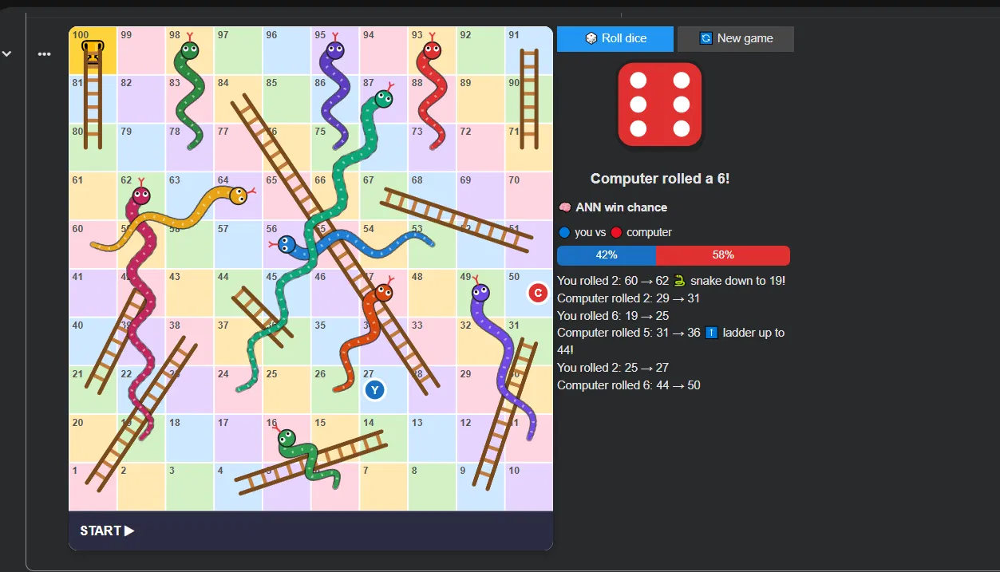
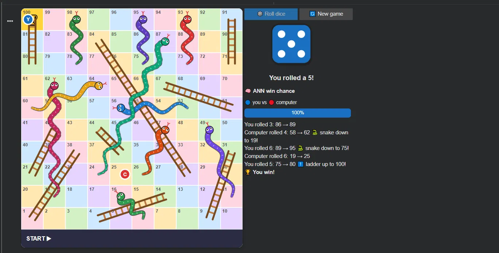

# 🐍 Snakes & Ladders: ANN Win Predictor + Playable Game

An Artificial Neural Network (ANN) built with Keras that predicts who is winning a game of Snakes & Ladders, plus a **playable, colourful version of the game** where you race the computer, watch animated dice rolls, and see the ANN's live win probability.

## Features

- 🎨 Colourful 10×10 board with **drawn snakes and ladders**
- 🎲 **Animated dice** for both you and the computer, with tokens walking square by square
- 🧠 **Live ANN win-chance bar** that updates after every move
- 📊 Full model evaluation: accuracy, precision, recall, F1, ROC-AUC, confusion matrix, ROC curve and training curves

## What's inside

| File | Description |
| `snakes_ladders_ann.ipynb` | Google Colab notebook: dataset, training, evaluation and the playable game |
| `snake_ladder_dataset.csv` | Simulated dataset of ~262,000 turns from 5,000 two-player games |

| Mid-game | Winning |
|---|---|
|  |  |

## How it works

1. **Dataset:** 5,000 random 2-player games are simulated on a standard 10×10 board (9 ladders, 10 snakes). Every turn is logged *before* the roll and saved to a CSV.
2. **Task:** binary classification. From the current board state, will the player about to roll eventually win?
3. **Model:** a feed-forward ANN (Dense 64 → 64 → 32 → 1 with BatchNorm, Dropout, early stopping).
4. **Evaluation:** metrics are compared against a simple "whoever is ahead wins" baseline. The train/test split is done **by game**, so no data leaks between sets.
5. **Game:** the trained model is used inside the game to estimate each side's chance of winning.

### Dataset columns

| Column | Meaning |

| `game_id` | Which game the row belongs to |
| `turn` | Turn number within the game (per player) |
| `my_pos` | Position of the player about to roll |
| `opp_pos` | Position of the opponent |
| `dice` | The die value the player then rolled |
| `mover_wins` | **Label:** 1 if the player about to roll went on to win |

The model uses `my_pos` and `opp_pos` (plus their difference) as features.

## Run it

1. Click the **Open in Colab** badge above.
2. Choose **Runtime ▸ Run all**.
3. Scroll to the last section and press **🎲 Roll dice** to play. Your turn plays out first, then the computer rolls automatically.

**Requirements** (already installed on Colab): `tensorflow`, `scikit-learn`, `pandas`, `numpy`, `matplotlib`, `ipywidgets`.

**A note on the numbers:** Snakes & Ladders is a game of pure chance, since every roll is random. No model can predict the winner with high accuracy, so don't expect results far above the baseline. The ANN's value is learning what each square is really worth (for example, a square just before a ladder), which gives a sensible win probability.

## Game rules used

- One die, two players (you vs computer), you move first.
- Landing on a ladder base climbs it; landing on a snake head slides down.
- You must not overshoot square 100. If the roll is too high, you stay put.
- First to reach 100 wins.

## Ideas for extension

- Add features such as distance to the next snake or ladder, or turn number
- Support 3–4 players
- Use a real dataset with the same columns
- Add a rule with choices (e.g. two tokens) so the ANN can pick moves, not just estimate odds

## License

MIT, see `LICENSE`.
